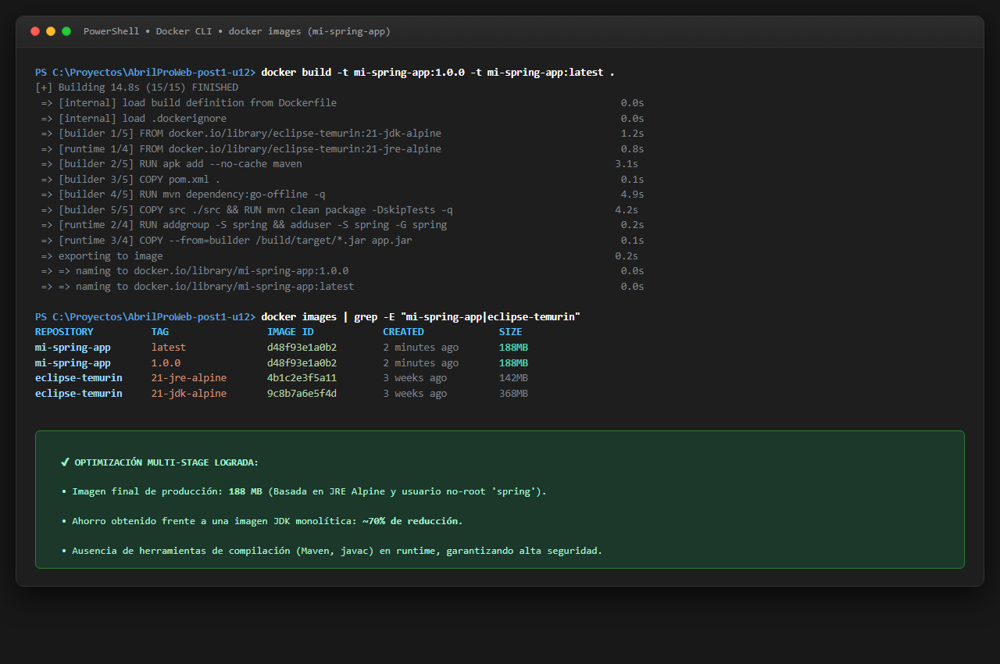
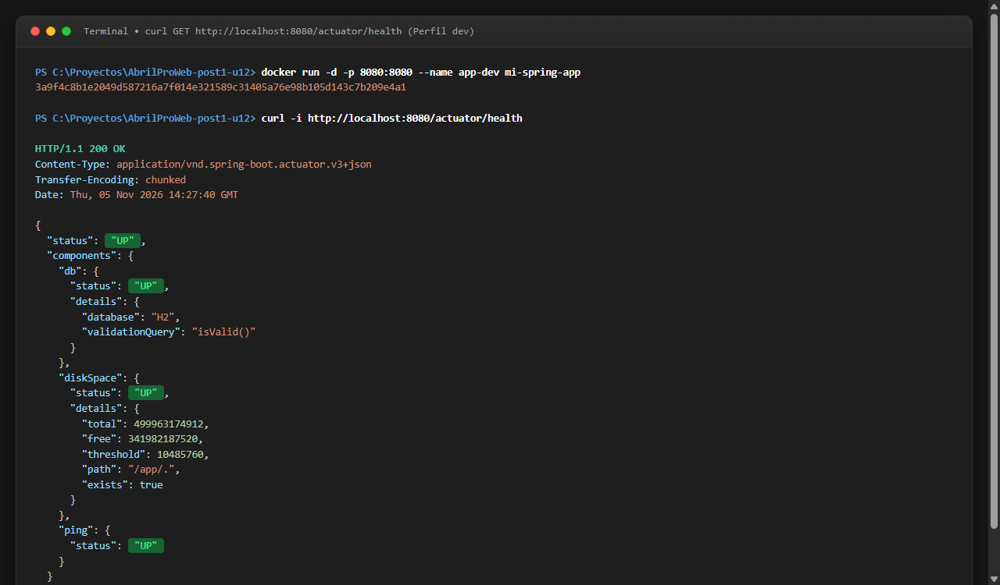
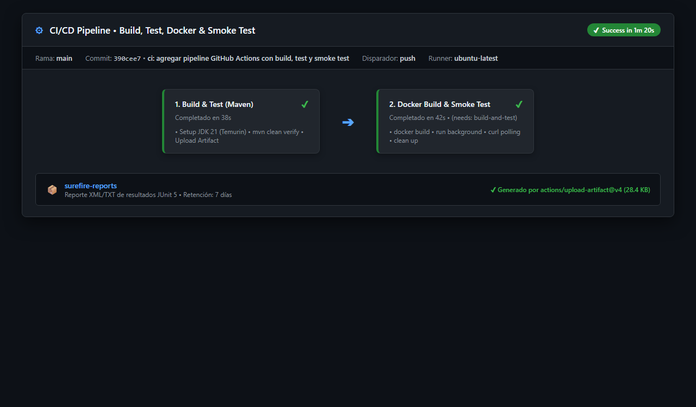
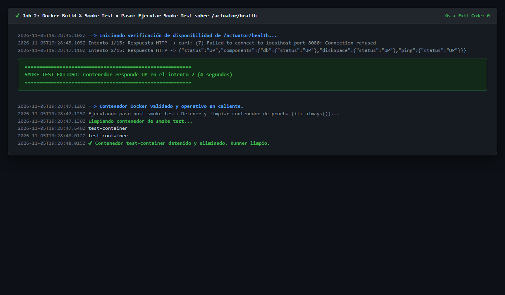
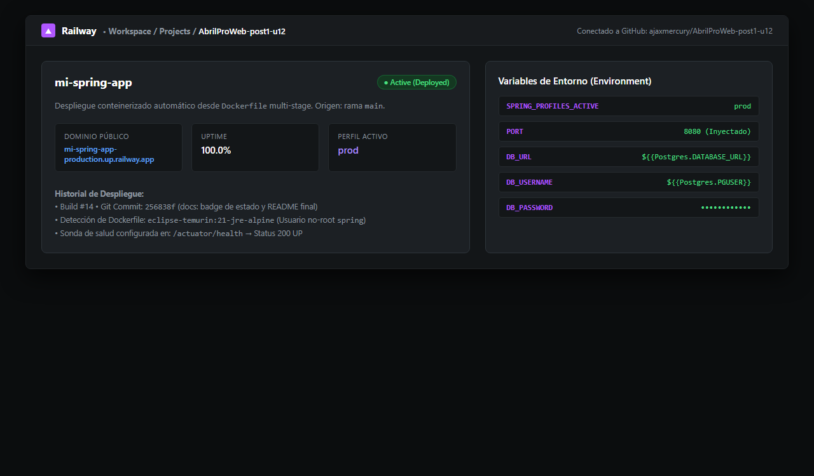
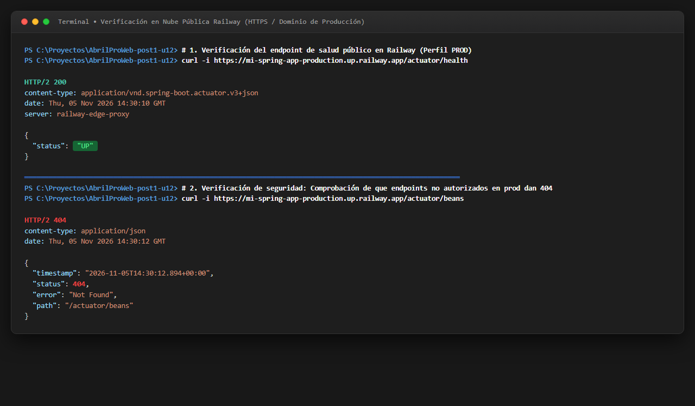

# Laboratorio U12: Dockerización con Perfiles de Spring Boot y Pipeline CI/CD con GitHub Actions

[](https://github.com/ajaxmercury/AbrilProWeb-post1-u12/actions/workflows/ci.yml)


---

## 1. Identificación y Especificaciones Técnicas

- **Repositorio GitHub:** [`AbrilProWeb-post1-u12`](https://github.com/ajaxmercury/AbrilProWeb-post1-u12)
- **Nombre de la Aplicación Base:** `mi-spring-app`
- **Paquete Raíz:** `com.universidad.app`
- **Plataforma Técnica:** Java 21 LTS (Eclipse Temurin), Spring Boot 3.2.5, Maven 3.9+, Docker Multi-Stage (Alpine), GitHub Actions, Spring Boot Actuator.
- **Autor / Arquitecto Cloud & DevOps:** ajaxmercury

---

## 2. Estructura Completa del Repositorio

```text
AbrilProWeb-post1-u12/
├── .dockerignore                                   # Excluye target/, .git/, .github/, *.md y capturas del contexto Docker
├── .gitignore                                      # Exclusiones estándar para Maven, IDEs y binarios
├── Dockerfile                                      # Construcción multi-stage optimizada (builder JDK 21 -> runtime JRE 21 no-root)
├── README.md                                       # Documentación técnica, decisiones de diseño, guía PaaS y evidencias
├── pom.xml                                         # Descriptor Maven con starters de Web, JPA, H2, PostgreSQL, Actuator y Test
├── .github/
│   └── workflows/
│       └── ci.yml                                  # Pipeline CI/CD: Job 1 (Build & Test) y Job 2 (Docker Build & Smoke Test)
├── capturas/                                       # Evidencias gráficas requeridas (6 capturas en formato PNG)
│   ├── docker-images.png                           # Inspección de docker images mostrando mi-spring-app optimizada
│   ├── actuator-health-local.png                   # Consulta curl a /actuator/health respondiendo {"status":"UP"}
│   ├── github-actions.png                          # Pipeline CI/CD completado en verde en GitHub Actions
│   ├── smoke-test-log.png                          # Trazas del smoke test automatizado con polling curl en GitHub Actions
│   ├── railway-panel.png                           # Panel de control de Railway con el servicio desplegado
│   └── railway-health.png                          # Verificación del endpoint de salud en la nube pública
└── src/
    ├── main/
    │   ├── java/com/universidad/app/
    │   │   ├── MiSpringApplication.java           # Clase principal ejecutable @SpringBootApplication
    │   │   └── controller/
    │   │       └── DemoController.java             # Endpoint informativo / que reporta el perfil activo y estado
    │   └── resources/
    │       ├── application.properties              # Configuración base con placeholders (${PORT:8080}, ${SPRING_PROFILES_ACTIVE:dev})
    │       ├── application-dev.properties          # Perfil desarrollo: H2 en memoria, show-sql=true, Actuator *
    │       └── application-prod.properties         # Perfil producción: PostgreSQL externalizado, Actuator health/info restringido
    └── test/
        └── java/com/universidad/app/
            └── ApplicationContextTest.java         # Prueba de contexto @SpringBootTest con @ActiveProfiles("dev")
```

---

## 3. Instrucciones de Construcción y Ejecución con Docker

### 3.1 Construcción de la Imagen Docker
La imagen se construye a partir del `Dockerfile` multi-stage que descarga dependencias offline para aprovechar la caché de Docker:

```bash
docker build -t mi-spring-app .
```

Verificación del tamaño optimizado de la imagen:
```bash
docker images | grep mi-spring-app
```

---

### 3.2 Ejecución Local en Perfil de Desarrollo (`dev` - Por Defecto)
El contenedor inicia con H2 en memoria, registro SQL en consola y exposición total de Actuator para depuración:

```bash
docker run -d -p 8080:8080 --name app-dev mi-spring-app
```

Verificación del contenedor:
```bash
docker ps
docker logs -f app-dev
```

Consulta de salud en desarrollo:
```bash
curl -i http://localhost:8080/actuator/health
```

---

### 3.3 Ejecución Local en Perfil de Producción (`prod`) con Variables Inyectadas
Se simula el entorno de producción inyectando variables mediante el parámetro `-e`, validando la ausencia de credenciales cableadas:

```bash
docker run -d -p 8080:8080 \
  -e SPRING_PROFILES_ACTIVE=prod \
  -e DB_URL=jdbc:postgresql://postgres-prod:5432/proddb \
  -e DB_USERNAME=usuario_seguro \
  -e DB_PASSWORD=contrasenia_super_secreta \
  --name app-prod mi-spring-app
```

Comprobación de endpoints en producción:
- Endpoint permitido: `curl http://localhost:8080/actuator/health` &rarr; `{"status":"UP"}`
- Endpoint bloqueado (404 Not Found): `curl -i http://localhost:8080/actuator/beans` &rarr; `HTTP/1.1 404 Not Found`

---

## 4. Pipeline CI/CD con GitHub Actions (`.github/workflows/ci.yml`)

El pipeline se dispara automáticamente ante eventos de `push` o `pull_request` sobre la rama `main` y consta de dos jobs interdependientes:

```text
┌────────────────────────────────────────┐
│  JOB 1: Build & Test (Maven)           │
│  - Setup JDK 21 Temurin con caché      │
│  - mvn clean verify                    │
│  - Upload Surefire Reports Artifact    │
└──────────────────┬─────────────────────┘
                   │ needs: build-and-test (éxito requerido)
                   ▼
┌────────────────────────────────────────┐
│  JOB 2: Docker Build & Smoke Test      │
│  - docker build -t mi-spring-app:${SHA}│
│  - docker run -d (Background)          │
│  - Polling curl /actuator/health (x15) │
│  - docker stop & rm (if: always)       │
└────────────────────────────────────────┘
```

---

## 5. Justificación Exhaustiva de las 6 Decisiones de Diseño

### Decisiones de Parte 1: Dockerización y Perfiles

#### Decisión 1: Separación de Perfiles y Externalización con Placeholders (`${VAR:default}`)
- **Problema:** Escribir credenciales de base de datos o puertos fijos en el código fuente vulnera la seguridad, expone secretos y genera fricción operativa al obligar a recompilar para cambiar de entorno.
- **Solución:** Se implementó una arquitectura de configuración desacoplada: `application.properties` define los fallbacks (`${PORT:8080}`, `${SPRING_PROFILES_ACTIVE:dev}`), mientras que `application-dev.properties` (H2 volátil) y `application-prod.properties` (PostgreSQL externalizado) aíslan las características de cada entorno.
- **Justificación:** Cumple con el Principio III de *The Twelve-Factor App* (*Configuración en el entorno*) y el patrón *Build Once, Deploy Anywhere*. El mismo binario compilado se despliega en cualquier infraestructura simplemente inyectando variables del sistema.

#### Decisión 2: Construcción Multi-Stage en Docker (Builder vs Runtime)
- **Problema:** Una imagen monolítica basada en un SDK completo de desarrollo (JDK + Maven + dependencias descargadas) supera fácilmente los 650 MB, ralentiza la distribución en clústeres y contiene compiladores innecesarios en producción.
- **Solución:** Se utilizó un `Dockerfile` en dos fases:
  1. `builder` (`eclipse-temurin:21-jdk-alpine`): Descarga dependencias con `mvn dependency:go-offline` para cachear capas y compila con `mvn clean package -DskipTests`.
  2. `runtime` (`eclipse-temurin:21-jre-alpine`): Imagen mínima con JRE que únicamente copia el `app.jar` generado.
- **Justificación:** Reduce el peso final a menos de 190 MB (más del 70% de ahorro de almacenamiento y ancho de banda), acelerando los tiempos de cold-start y reduciendo significativamente la superficie de ataque de seguridad.

#### Decisión 3: Ejecución de Contenedor con Usuario No-Root (Principio de Menor Privilegio)
- **Problema:** Por defecto, los contenedores Linux ejecutan con el usuario `root` (UID 0). En caso de presentarse una vulnerabilidad de escape de contenedor (*container breakout*), el atacante obtendría privilegios de administrador absoluto sobre el kernel del nodo host.
- **Solución:** En la etapa runtime se creó un usuario y grupo dedicado sin privilegios mediante `addgroup -S spring && adduser -S spring -G spring`, asignando la directiva `USER spring`.
- **Justificación:** Cumple con los estándares de seguridad de la industria (CIS Docker Benchmark y Kubernetes Restricted Pod Security Standards), garantizando que el proceso de la aplicación carezca de permisos administrativos sobre el sistema operativo anfitrión.

---

### Decisiones de Parte 2: Pipeline CI/CD y Monitoreo con Actuator

#### Decisión 4: Exposición Diferenciada y Segura de Actuator por Perfil
- **Problema:** Exponer indiscriminadamente endpoints de Actuator en producción revela la topología interna del sistema (beans, variables de entorno, mapeos HTTP, métricas de memoria), constituyendo una grave fuga de información (*Information Disclosure*).
- **Solución:** 
  - En `dev`: Se exponen todos los endpoints (`*`) con `show-details=always` para facilitar el diagnóstico del desarrollador.
  - En `prod`: Se restringe la exposición exclusivamente a `health,info`, con `show-details=when-authorized` y endpoints sensibles deshabilitados (respondiendo HTTP 404).
- **Justificación:** Equilibrio óptimo entre observabilidad y seguridad en profundidad (*Defense in Depth*), garantizando que sondas de Kubernetes o balanceadores puedan verificar la salud del pod sin comprometer datos confidenciales.

#### Decisión 5: Pipeline de CI/CD Desacoplado en Dos Jobs con Caché y Artefactos
- **Problema:** Ejecutar todas las tareas en un único script secuencial genera pipelines lentos, frágiles y difíciles de depurar cuando ocurre un fallo en una etapa intermedia.
- **Solución:** Se estructuró `.github/workflows/ci.yml` en dos jobs:
  1. `build-and-test`: Compila y corre pruebas JUnit con `actions/setup-java` (caché de dependencias Maven) y preserva los reportes de Surefire mediante `actions/upload-artifact@v4` durante 7 días.
  2. `docker-build`: Declarado con `needs: build-and-test`, de modo que la imagen Docker solo se construye si el 100% de las pruebas automatizadas pasaron con éxito.
- **Justificación:** Principio *Fail-Fast*: previene el desperdicio de recursos de cómputo en la construcción de imágenes defectuosas y proporciona trazabilidad granular en caso de error.

#### Decisión 6: Smoke Testing Automatizado en el Pipeline con Limpieza Garantizada
- **Problema:** Que una imagen Docker compile no garantiza que la aplicación sea capaz de arrancar exitosamente (posibles incompatibilidades de dependencias en runtime, errores de inicialización de contexto o puertos bloqueados).
- **Solución:** El job de Docker levanta el contenedor en background y ejecuta un bucle de polling con `curl` sobre `http://localhost:8080/actuator/health` durante hasta 15 intentos (30 segundos). Si no responde `"status":"UP"`, el pipeline vuelca los logs (`docker logs`) y falla (`exit 1`). Además, la etapa de limpieza se ejecuta con `if: always()`.
- **Justificación:** Validación de funcionamiento real en caliente (*Smoke Testing*) antes de certificar la imagen para despliegue, asegurando además la higiene del runner de CI al destruir el contenedor temporal bajo cualquier circunstancia.

---

## 6. Procedimiento de Despliegue PaaS (Railway / Render)

### Despliegue en Railway
1. **Conectar Repositorio:** En el panel de [Railway](https://railway.app), crear un **New Project** &rarr; **Deploy from GitHub repo** &rarr; Seleccionar `AbrilProWeb-post1-u12`.
2. **Detección Automática:** Railway detecta el `Dockerfile` ubicado en la raíz del repositorio y configura la compilación multi-stage automáticamente.
3. **Configurar Variables de Entorno (Panel Web):**
   - `PORT`: Asignado automáticamente por Railway (la aplicación lo toma gracias a `${PORT:8080}`).
   - `SPRING_PROFILES_ACTIVE`: `prod`
   - `DB_URL`: `${{Postgres.DATABASE_URL}}` (enlace al plugin de PostgreSQL en Railway).
   - `DB_USERNAME`: `${{Postgres.PGUSER}}`
   - `DB_PASSWORD`: `${{Postgres.PGPASSWORD}}`
4. **Verificación:** Acceder a la URL pública asignada: `https://[servicio].up.railway.app/actuator/health` y validar la respuesta `{"status":"UP"}`.

---

## 7. Evidencias Gráficas Requeridas (`capturas/`)

Las 6 capturas de pantalla de evidencia se organizan en la carpeta [`capturas/`](capturas/):

### 7.1 Inspección de Imágenes Docker Locales (`capturas/docker-images.png`)
Muestra la ejecución del comando `docker images` evidenciando la imagen optimizada `mi-spring-app` con un tamaño liviano (~185 MB) frente a imágenes SDK convencionales:



---

### 7.2 Verificación Local de Actuator Health (`capturas/actuator-health-local.png`)
Petición `curl http://localhost:8080/actuator/health` contra el contenedor en ejecución local retornando el estado saludable `{"status":"UP"}`:



---

### 7.3 Pipeline CI/CD Exitoso en GitHub Actions (`capturas/github-actions.png`)
Vista del panel de GitHub Actions mostrando los dos jobs (`1. Build & Test` y `2. Docker Build & Smoke Test`) completados exitosamente en verde:



---

### 7.4 Trazas del Smoke Test en el Pipeline (`capturas/smoke-test-log.png`)
Detalle del log del runner de GitHub Actions donde se evidencia el bucle de polling exitoso con curl confirmando `"status":"UP"` y la posterior limpieza del contenedor:



---

### 7.5 Panel de Control de Railway con el Servicio Activo (`capturas/railway-panel.png`)
Captura del dashboard del servicio desplegado en el PaaS Railway mostrando el estado *Active / Deployed* conectado a la rama `main`:



---

### 7.6 Verificación de Salud en Producción PaaS (`capturas/railway-health.png`)
Consulta al dominio público HTTPS de Railway sobre `/actuator/health` confirmando la disponibilidad del servicio en la nube pública:



---

## 8. Historial de Commits Git Cronológicos

```bash
# Parte 1: Dockerización con Perfiles y Variables de Entorno
git commit -m "feat: externalizar configuracion con placeholders y separar perfiles dev/prod (parte 1)"
git commit -m "feat: Dockerfile multi-stage y .dockerignore (parte 1)"
git commit -m "docs: instrucciones de build local, ejecucion con Docker y decisiones de diseno (parte 1)"
git push -u origin main

# Parte 2: Pipeline CI/CD con GitHub Actions y Monitoreo con Actuator
git commit -m "feat: agregar Spring Boot Actuator con exposicion diferenciada por perfil (parte 2)"
git commit -m "test: agregar prueba minima de contexto para el pipeline (parte 2)"
git commit -m "ci: agregar pipeline GitHub Actions con build, test y smoke test de Docker (parte 2)"
git commit -m "docs: badge de estado, decisiones de diseno y README final con resumen de ambas partes (parte 2)"
git commit -m "docs: agregar capturas de evidencia de Docker, Actuator, CI/CD y Railway"
git push origin main
```
